# UI {#sec-shiny-ui .unnumbered}

## Misc {#sec-shiny-ui-misc .unnumbered}

- Packages
  - [{]{style="color: goldenrod"}[brand_yml](https://posit-dev.github.io/brand-yml/){style="color: goldenrod"}[}]{style="color: goldenrod"} - Create reports, apps, dashboards, plots and more that match your company’s brand guidelines with a single `_brand.yml` file

    - For Quarto dashboards, websites, reports, etc.
    - For Python shiny, seaborn, matplotlib, etc.
    - For R shiny, ggplot2, plot, RMarkdown

  - [{]{style="color: #990000"}[calcite](https://r.esri.com/calcite/){style="color: #990000"}[}]{style="color: #990000"} ([Demo](https://r.esri.com/calcite/), [Repo](https://github.com/r-arcgis/calcite)) - R bindings to [Esri’s Calcite Design System](https://developers.arcgis.com/calcite-design-system/), designed to work directly with Shiny or standalone HTML.

    - Essentially a full screem map app with a slim sidebar

  - [{]{style="color: #990000"}[dockviewR](https://cynkra.github.io/dockViewR/){style="color: #990000"}[}]{style="color: #990000"} - An interactive layout manager for Shiny apps and interactive R documents. It builds on top of [dockview](#0).

  - [{]{style="color: #990000"}[imola](https://www.anatomyofcode.com/imola/){style="color: #990000"}[}]{style="color: #990000"} - CSS Grid and flexbox layouts for R/Shiny (e.g. allows you to put that side panel in other locations)

  - [{]{style="color: #990000"}[linkeR](https://epiforesite.github.io/linkeR/){style="color: #990000"}[}]{style="color: #990000"} - Creates linked views in Shiny applications. When users interact with one component (like clicking a map marker), all related components (tables, charts, other maps) automatically update to show corresponding information.

    |  |  |  |
    |----|----|----|
    | Leaflet Maps | ✅ Full Support | Interactive maps with markers, circles, polygons |
    | DT DataTables | ✅ Full Support | Sortable, filterable tables |
    | Plotly Charts | 🔄 Partial | Requires manual event handling |
    | Custom Components | 🔄 Partial | Any Shiny component with click events, Requires manual event handling |
    | Base R Plots | 📋 Planned | Static plots with click detection |
    | Mapbox | 📋 Planned | Alternative mapping solution |

  - [{]{style="color: #990000"}[litter](https://litter.opifex.org/){style="color: #990000"}[}]{style="color: #990000"} - [Lit](https://lit.dev/) components for shiny, with a twist.

    - Allows you to "observe" on any valid selector such as a .class (as opposed to shiny which can only observe on #id), this means one can have a single observe for multiple inputs.
    - Create inputs that, instead of inputId, take a name argument which can be shared by multiple inputs. This makes it possible to sensibly dynamically generate inputs in R as each input does not need its corresponding observer.
    - Limitations
      - Only works with bslib's Bootstrap 5.
      - These inputs are not captured by Shiny's bookmarking session
      - These inputs are not captured by shinytest2

  - [{]{style="color: #990000"}[resizableSplitLayout](https://cran.r-project.org/web/packages/resizableSplitLayout/index.html){style="color: #990000"}[}]{style="color: #990000"} - Facilitate page layouts with resizable panes for page content based on 'split.js' 'JavaScript' library (<https://split.js.org/>)

    - Has an interactive bar down the middle of the UI that allows you slide left or right which controls the width of each pane.

  - [{]{style="color: #990000"}[tabler](https://github.com/pachadotdev/tabler){style="color: #990000"}[}]{style="color: #990000"} - Tabler Dashboard for Shiny: A modern dashboard framework for R Shiny using the beautiful Tabler Bootstrap theme. ([tabler js site](https://tabler.io/admin-template), [github](https://github.com/tabler/tabler))

  - [{]{style="color: goldenrod"}[shiny_adaptive_filter](https://github.com/chendaniely/pyshiny_adaptive_filter){style="color: goldenrod"}[}]{style="color: goldenrod"} - Filters that are aware of what the other filters were doing, and updates their own values according to the other filters.

  - [{]{style="color: #990000"}[shinyLP](https://jasminedaly.com/shinyLP/){style="color: #990000"}[}]{style="color: #990000"} - Functions that wrap HTML Bootstrap code to enable the design and layout of informative landing home pages for Shiny applications

  - [{]{style="color: #990000"}[shiny.fluent](https://appsilon.github.io/shiny.fluent/){style="color: #990000"}[}]{style="color: #990000"}, [{]{style="color: #990000"}[shiny.blueprint](https://appsilon.github.io/shiny.blueprint/){style="color: #990000"}[}]{style="color: #990000"}, [{]{style="color: #990000"}[shiny.semantic](https://appsilon.github.io/shiny.semantic/){style="color: #990000"}[}]{style="color: #990000"}, [{]{style="color: #990000"}[semantic.dashboard](https://appsilon.github.io/semantic.dashboard/){style="color: #990000"}[}]{style="color: #990000"} - Appsilon UI theming packages

    - [{semantic.dashboard}]{style="color: #990000"} is a dashboard template that uses [{shiny.semantic}]{style="color: #990000"} theming
- Resources
  - [Outstanding User Interfaces with Shiny](https://unleash-shiny.rinterface.com/)
  - [JavaScript 4 Shiny - Field Notes](https://connect.thinkr.fr/js4shinyfieldnotes/)
  - [Javascript for R](https://book.javascript-for-r.com/)
  - [R Shiny Applications in Finance, Medicine, Pharma and Education Industry](https://kimloanrobinson.shinyapps.io/r_shiny_book_web/)

## Design Principles {#sec-shiny-ui-desprin .unnumbered}

- Misc
  - Notes from
    - Erik Kennedy [thread](https://twitter.com/erikdkennedy/status/1610371533784100864)
- De-Emphasize Dividing lines\
  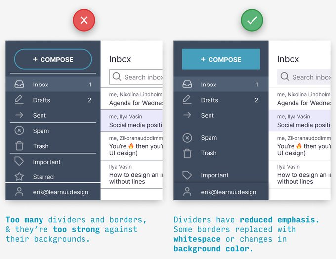{.lightbox width="532"}
- Use variatios of the primary color ([source](https://www.learnui.design/blog/color-in-ui-design-a-practical-framework.html))
  - Also see [Visualization, General \>\> Colors](visualization-general.qmd#sec-vis-gen-color){style="color: green"} \>\> Adjustments once you've chosen a color (hue) to create variations upon
  - Navbar, Search, Icons\
    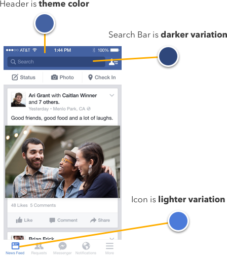{.lightbox width="432"}
  - One color as a theme (e.g. ocean)\
    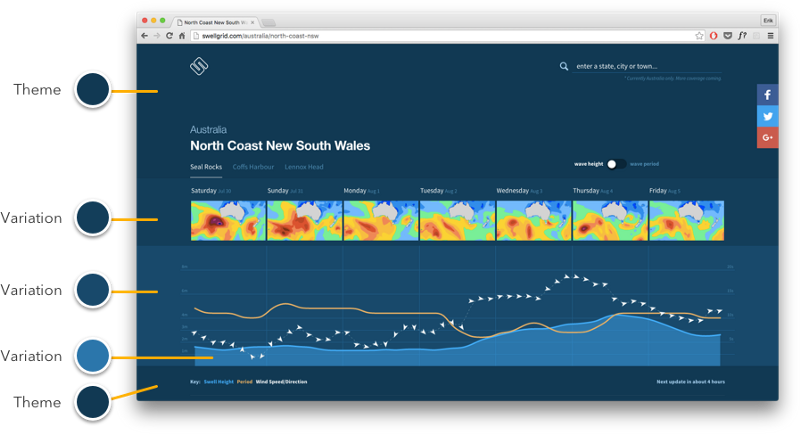{.lightbox width="532"}
  - Tabs and Buttons: Active, Inactive, Hover\
    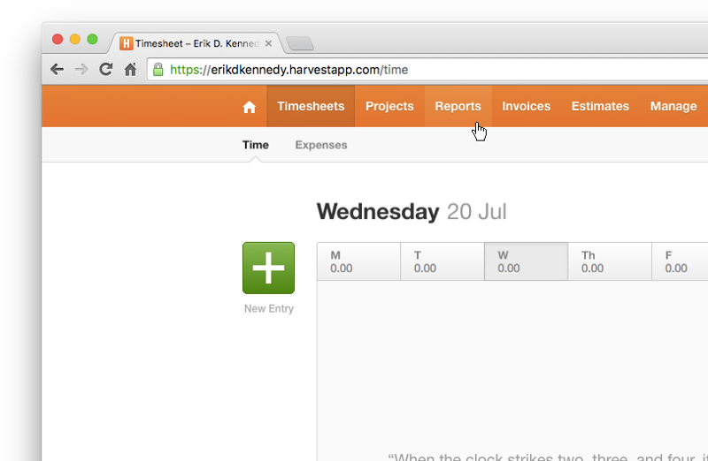{.lightbox width="482"}
- Use fonts that subtly convey brand\
  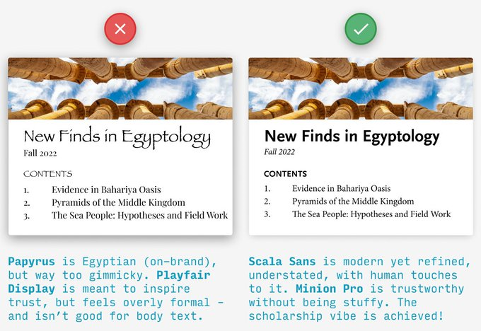{.lightbox width="532"}
- Content cards should be lighter than their bg (in dark mode too)\
  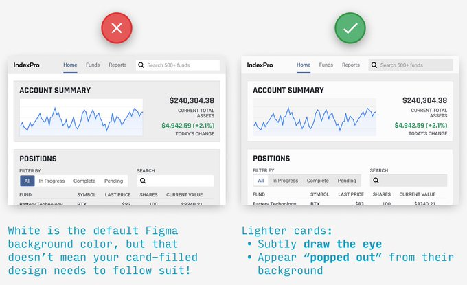{.lightbox width="532"}
- Don’t resize icons\
  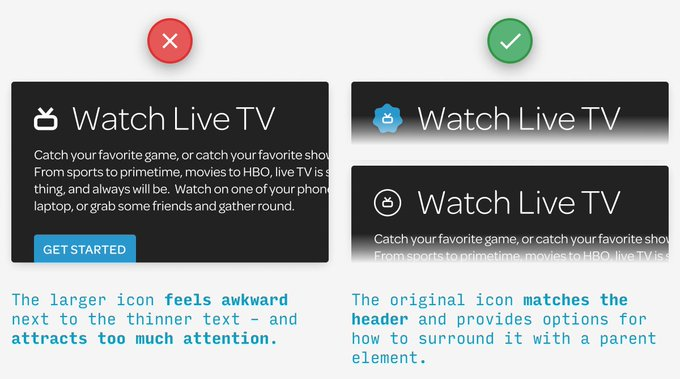{.lightbox width="532"}
  - Their level of detail and stroke weights are meant to work best at a certain size.
  - Instead, try adding a border or container around them for some extra visual pop
- REMOVE-HIDE-LIGHTEN for cleaner designs\
  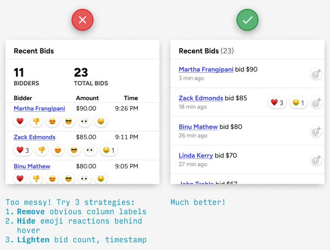{.lightbox width="532"}
- Be consistent until it's time not to be consistent\
  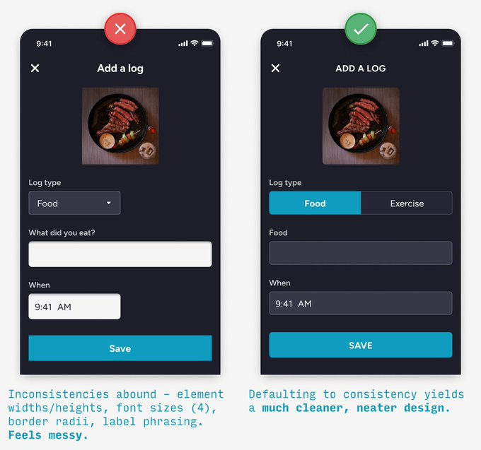{.lightbox width="532"}
  - Break consistency example: when you're trying to catch the user's eye
- Good imagery\
  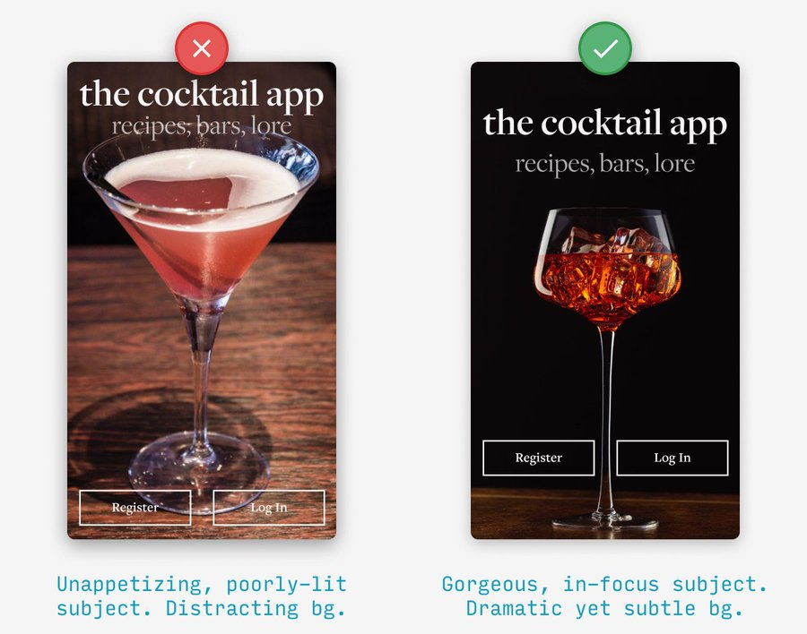{.lightbox width="532"}
- Remove Congestion
  - See [Designing Accessible Research with R/Shiny UI – Part 2](https://www.r-bloggers.com/2023/01/designing-accessible-research-with-r-shiny-ui-part-2/) for an example of an iterable workflow
  - Congestion is when an app shows everything, all at once and that’s stressful for the user. It doesn’t elicit the behavior we want for an engaging, learning experience.
  - This stress triggers two subconscious actions – run or freeze. Both lead to cognitive load and negative perception, and ultimately, failed adoption.
    - Running is expressed in bounce rate. A user will enter the app, become frustrated, and leave.
    - Freezing means that a user pauses with a delayed time to understand. This can be expressed in a number of ways, but most likely a combination of longer session times with aimless user behavior.
  - Minimize options, legends, etc. and move to the edges of the app (e.g. header, sides)
    - [Example]{.ribbon-highlight}
      - Prototype\
        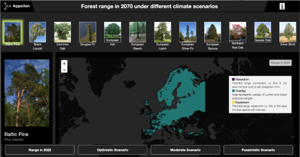{.lightbox group="minmap" width="432"}
        - Issues
          - The tree selector consumes space on the dashboard
          - Selecting via images doesn’t add a lot of value as not all tree species are easily identified by image
          - The UI is too dark
          - The visual accessibility feature was lost as some colors don’t work on a dark background
      - Final
        - Dashboard\
          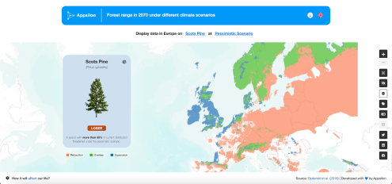{.lightbox group="minmap" width="432"}

          - The legend moved to the card (see mobile for more details
            - Tree card gives details about species and a summary
            - Clicking upper right icon flips the card to display the bar chart.
          - Switching languages and information about the application moved to the header (right side of blue nav bar)
          - Clicking text in header opens pop-up with options. One for type of tree and one for type of scenario (beteen blue nav bar and map)
          - All other interactive elements that were scattered on the screen are now organized into the right vertical panel on the map. Here is also the color blindness option for people with visual disabilities, as the main focus of the application is on the color ratio on the map

        - Mobile\

          ::: {layout-ncol="3"}
          .png){.lightbox group="mobile" width="232"}

          .png){.lightbox group="mobile" width="232"}

          .png){.lightbox group="mobile" width="232"}
          :::

          - “languages” and “about” moved to the top

## Style {#sec-shiny-ui-style .unnumbered}

- Misc
  - Images and style.css files should go into the "www" folder
- Implementing a css file
  - [Example]{.ribbon-highlight}: Basic\
    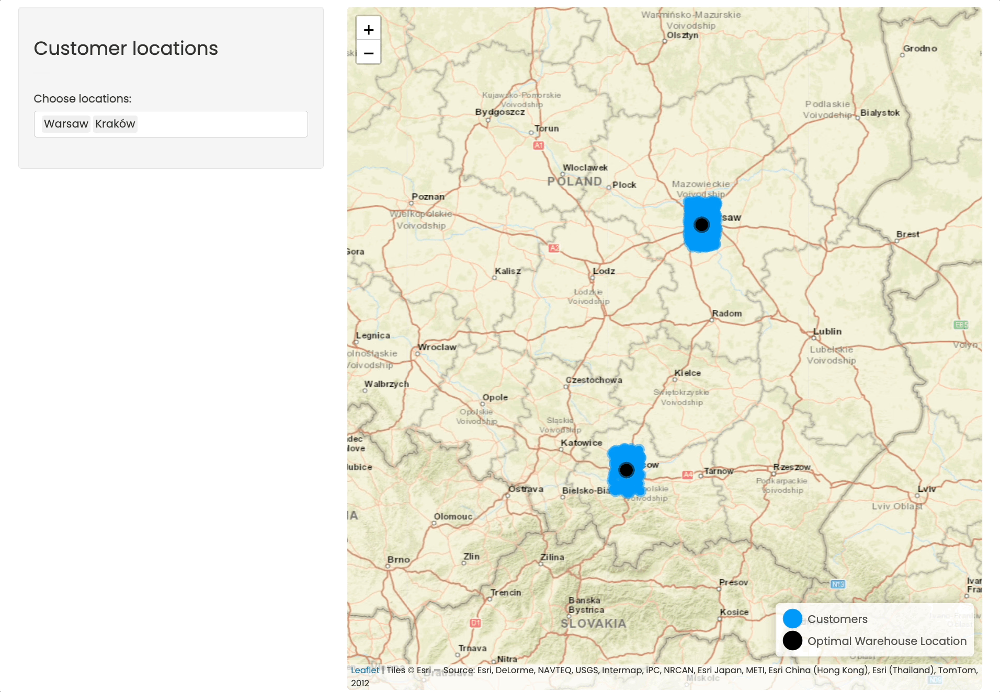{.lightbox width="432"}
    - main.css file

      ``` css
      @import url('https://fonts.googleapis.com/css2?family=Poppins&display=swap');
      * {
        margin: 0;
        padding: 0;
        box-sizing: border-box;
        font-family: 'Poppins', sans-serif;
      }
      body {
        padding: 1rem;
      }
      #map {
        height: 98vh !important;
        border-radius: 0.5rem !important;
      }
      ```

    - app.R

      ``` r
      ui <- fluidPage(
        tags$head(tags$link(rel = "stylesheet", type = "text/css", href = "main.css")),
        sidebarLayout(
          ...
        )
      )
      ```

## Responsiveness {#sec-shiny-ui-resp .unnumbered}

- Responsiveness isn’t the same as performance. Performance is about completing an operation in the minimal amount of time, while responsiveness is about meeting human needs for feedback when executing an action

- Misc

  - Notes from [Improving the responsiveness of Shiny applications](https://www.r-bloggers.com/2023/01/improving-the-responsiveness-of-shiny-applications/)

- Button Click Registered

  ::: {layout-ncol="3"}
  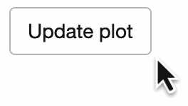{.lightbox group="butreg" width="132"}

  .png){.lightbox group="butreg" width="132"}

  .png){.lightbox group="butreg" width="132"}
  :::

  - (Left) Default arrow for your app

  - (Middle) Hand indicates to the user that the app has registered their hovering over a button

  - (Right) Arrow + Pie indicates to the user that the app has registered their clicking the button

  - (generic) entry into CSS file

    ``` css
    html.shiny-busy .container-fluid {
      cursor: wait;
    }
    ```

    - Looks like this code is to produce something like the right-side image

- For touch devices (i.e. without cursor), you might want to take a look at [{]{style="color: #990000"}[shinycssloaders](https://github.com/daattali/shinycssloaders){style="color: #990000"}[}]{style="color: #990000"} and/or [{]{style="color: #990000"}[waiter](https://shiny.john-coene.com/waiter/){style="color: #990000"}[}]{style="color: #990000"}

- If the user might have to wait longer than a few seconds for the process they’ve just set in motion to complete, you should consider a progress indicator.

  - [{]{style="color: #990000"}[shiny](https://shiny.rstudio.com/gallery/progress-bar-example.html){style="color: #990000"}[}]{style="color: #990000"} has a progress indicator, while [{]{style="color: #990000"}[waiter](https://shiny.john-coene.com/waiter/){style="color: #990000"}[}]{style="color: #990000"} also offers a nice built-in-to-button option

    ::: {layout-ncol="2"}
    .png){.lightbox group="progbut" width="132"}

    .png){.lightbox group="progbut" width="132"}
    :::

## JS {#sec-shiny-ui-js .unnumbered}

### Misc {#sec-shiny-ui-js-misc .unnumbered}

- Packages
  - [{]{style="color: #990000"}[shinyreact](https://posit-dev.github.io/shinyreact/){style="color: #990000"}[}]{style="color: #990000"} ([Intro](https://opensource.posit.co/blog/2026-09-30_introducing-shinyreact/), [Examples](https://github.com/schloerke/presentation-2026-09-15-posit-conf-shinyreact)) - The Shiny server (Python or R) contains only reactive computation, and the UI is a React client you own. shinyreact is the bridge between the two; it ships zero UI components itself.
- Cheatsheet ([source](https://bsky.app/profile/gd047.bsky.social/post/3ldbn5nrons2r))\
  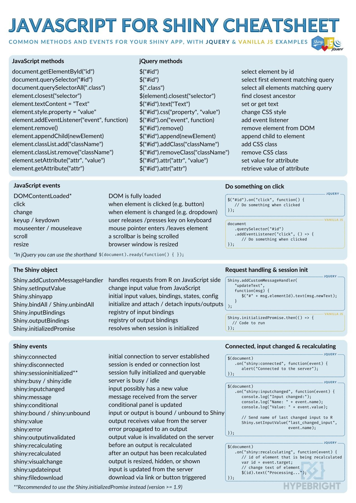{.lightbox width="376"}
- `www` - Directiory for images, styles, or JS script. Same directory as `app.R`
- Use a javascript file + library

### Examples {#sec-shiny-ui-js-ex .unnumbered}

- [Example]{.ribbon-highlight} Stylish Pop-Up Notification

  ::: panel-tabset
  ## JS Script

  ``` javascript
  // JS script; basic toastify notification
  Shiny.addCustomMessageHandler('notify', 
                                function(msg){
                                  Toastify({
                                    text: msg
                                  }).showToast();
                                });
  ```

  - Keep in `www`
  - [toastify.js](https://github.com/apvarun/toastify-js/blob/master/README.md) is a library for some snazzy notifications you can use that pop-up in your browser when a event (e.g. button pushed) has happened.
  - `addCustomMessageHandler` is a js function that receives the message from the server
    - "notify" is the identifer that it listens for
    - `Toastify()` takes a JSON formatted list of args
    - `showToast` method sends snazzy notification to the user's browser.

  ## UI and Server

  ``` r
  ui <- fluidPage(
    tags$head(
      # toastify css dependency
      tags$link(
        rel = "stylesheet",
        type = "text/css",
        href = "https://cdn.jsdelivr.net/npm/toastify-js/src/toastify.min.css"
      ),
      # our script
      tags$script(
        type = "text/javascript",
        src = "script.js"
      )
    ),
    h1("Notifications"),
    textInput("text", "Text"),
    actionButton("show", "Show"),
    # toastify js dependency
    tags$script(
      type = "text/javascript",
      src = "https://cdn.jsdelivr.net/npm/toastify-js"
    )
  )
  server <- function(input, output, session) {
    observeEvent(input$show, {
      session$sendCustomMessage(
        "notify",
        input$text
    })
  }
  shinyApp(ui, server)
  ```

  - Button is pressed in ui, sends "message" (text, data.frame, etc.) to server, server sends "message" to js script in ui which triggers a notification in the browser.
  - UI
    - `tags$head` includes:
      - `tags$link` links to the toastify CSS stylesheet
      - `tags$script` points to the path of the js script and provides the identifier ("type"), "text/javascript"
    - `tags$script` links to the toastify js dependency and also has the identifier, "text/javascript"
  - Server
    - `ObserveEvent` listens for ui input "show" button to be pressed
    - `sendCustomMessage` is a js function to send a message from the server to the browser
      - identifier ("type") = "notify" says which custom handler to use in the js script
  :::

- [Example]{.ribbon-highlight}: DT table and Leaflet (sort of) sync ([source](https://github.com/rstudio/shiny-examples/blob/main/063-superzip-example/gomap.js))

  ::: panel-tabset
  ## JS Script

  `gomap.js`

  ``` javascript
  // When locator icon in datatable is clicked, go to that spot on the map
  $(document).on("click", ".go-map", function(e) {
    e.preventDefault();
    $el = $(this);
    var lat = $el.data("lat");
    var long = $el.data("long");
    var zip = $el.data("zip");     // this one    
    $($("#nav a")[0]).tab("show"); // this one
    Shiny.onInputChange("goto", {
      lat: lat,
      lng: long,
      zip: zip,                    // and this one
      nonce: Math.random()
    });
  });
  ```

  - This [example](https://github.com/Hong-Kong-Districts-Info/hktrafficcollisions/blob/main/inst/app/modules/gomap.js) had a few of the lines deleted (indicated in the comments)

  ## UI and Server

  words

  ``` r
  # ui --------------

  navbarPage("Superzip", id="nav",

             tabPanel("Interactive map",
                      div(class="outer",

                          tags$head(
                            # Include our custom CSS
                            includeCSS("styles.css"),
                            includeScript("gomap.js")
                          ),
                          ...,
                          ...
                      )
             )
  )

  # server ----------------

  observe({
    if (is.null(input$goto))
      return()
    isolate({
      map <- leafletProxy("map")
      map %>% clearPopups()
      dist <- 0.5
      zip <- input$goto$zip
      lat <- input$goto$lat
      lng <- input$goto$lng
      showZipcodePopup(zip, lat, lng)
      map %>% fitBounds(lng - dist, lat - dist, lng + dist, lat + dist)
    })
  })

  output$ziptable <- DT::renderDataTable({
    df <- cleantable %>%
      filter(
        Score >= input$minScore,
        Score <= input$maxScore,
        is.null(input$states) | State %in% input$states,
        is.null(input$cities) | City %in% input$cities,
        is.null(input$zipcodes) | Zipcode %in% input$zipcodes
      ) %>%
      mutate(Action = paste('<a class="go-map" href="" data-lat="', Lat, '" data-long="', Long, '" data-zip="', Zipcode, '"><i class="fa fa-crosshairs"></i></a>', sep=""))
    action <- DT::dataTableAjax(session, df, outputId = "ziptable")

    DT::datatable(df, options = list(ajax = list(url = action)), escape = FALSE)
  })
  }
  ```

  - Also see this [example](https://github.com/Hong-Kong-Districts-Info/hktrafficcollisions/blob/7b7a9d17ebac01363d257c1627911b526ba2e3b0/inst/app/modules/hotzones.R#L73)
  :::

- [Example]{.ribbon-highlight}: Download code from a LLM chat window ([source](https://gist.github.com/smach/f38c61ec9a8ad4649f43cd8a134db687), [article](https://www.infoworld.com/article/3848270/genai-tools-for-r-new-tools-to-make-r-programming-easier.html))

  ``` r
  # Attach a JavaScript snippet to handle the download.
  # When the download button is clicked, the script extracts the text inside
  # the chat's <shiny-chat-messages> element, creates a Blob from it, and triggers a download.
  ui <- tagList(
    ui,
    tags$script(HTML("
      document.addEventListener('DOMContentLoaded', function() {
        document.getElementById('downloadChat').addEventListener('click', function() {
          // Find the chat container by the id you provided to chat_ui()
          var chatContainer = document.getElementById('chat');
          if (!chatContainer) return;
          // The chat messages are rendered inside the <shiny-chat-messages> element
          var chatMessages = chatContainer.querySelector('shiny-chat-messages');
          if (!chatMessages) return;
          // Get the visible text (this will strip extra formatting)
          var text = chatMessages.innerText;
          // Create a blob and a temporary anchor to trigger download
          var blob = new Blob([text], { type: 'text/plain' });
          var url = URL.createObjectURL(blob);
          var a = document.createElement('a');
          a.href = url;
          a.download = 'chat.txt';
          document.body.appendChild(a);
          a.click();
          document.body.removeChild(a);
          URL.revokeObjectURL(url);
        });
      });
    "))
  )
  ```
